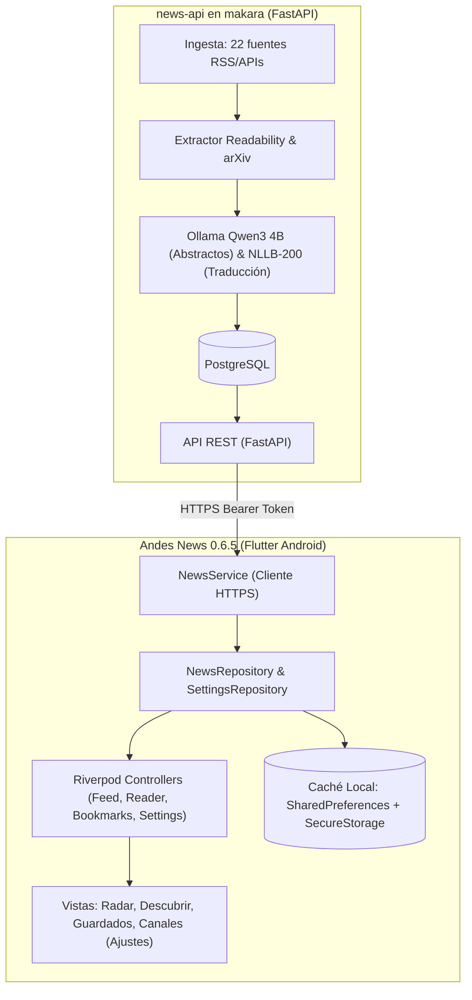

# Andes News (Cliente Android)

Aplicación móvil nativa en Flutter (versión 0.6.5, Build 11) para Android, diseñada para lectura técnica de noticias, ingeniería de software, arquitectura de sistemas e inteligencia artificial para Perú y Latinoamérica.

El cliente consume los artículos procesados y enriquecidos desde el backend [news-api](https://andes-news.cmaquera.com), el cual recopila fuentes especializadas, extrae el contenido sin distracciones ni publicidad, ejecuta pipelines de inferencia local con Ollama / Qwen3 y traduce titulares y contenido técnico al español mediante NLLB-200.

---

## Arquitectura del Sistema



La app móvil no realiza scraping directo ni ejecuta modelos de lenguaje pesados en el dispositivo del usuario. Todo el procesamiento editorial y de inteligencia se resuelve previamente en el servidor. La aplicación se encarga de la visualización fluida, la navegación estructurada, la lectura sin conexión y el filtrado local no destructivo por canales.

---

## Características Principales

### 1. Sistema Dinámico de Canales (v0.6.5)
- El backend agrupa las 22 fuentes activas en canales consolidados expuestos en `GET /sources`:
  - **Blogs y Feeds RSS**: Fuentes de ingeniería y blogs técnicos oficiales.
  - **Medios y Portales Tech**: Portales de tecnología y análisis de software.
  - **Ecosistema Open Source**: Registros de cambios, lanzamientos y repositorios.
  - **Comunidades de Desarrolladores**: Artículos y tutoriales de comunidades abiertas.
  - **Plataformas de Discusión**: Agregadores de discusión técnica.
- **Filtrado no destructivo**: En la pantalla de Configuración (`Ajustes`), el usuario puede activar o desactivar canales completos. La sincronización en segundo plano continúa descargando todas las noticias para mantener la caché intacta; el filtrado opera a nivel de vista en el Radar y Descubrir.
- **Conteo en tiempo real**: Cada canal muestra dinámicamente la cantidad de fuentes que agrupa (`X fuentes`) y un subtítulo explicativo.

### 2. Lector Nativo sin Distracciones
- **Doble Modo**: Alternancia instantánea entre el **Abstracto** (resumen ejecutivo de hasta 160 palabras con puntos clave generado por IA) y el **Artículo Limpio**.
- **Traducción Técnica**: Selector para alternar entre el texto en español traducido y el contenido original en inglés, conservando bloques de código intactos.
- **Elementos Ricos**: Renderizado nativo de párrafos, encabezados, bloques de código monospace, citas destacadas, tablas con desplazamiento horizontal y soporte para imágenes y videos embebidos.

### 3. Modo Offline y Caché Resiliente
- Almacenamiento seguro del token de acceso (`FlutterSecureStorage`).
- Almacenamiento local persistente (`SharedPreferences`) para las noticias del feed y artículos guardados.
- Si se pierde la conexión a internet, la aplicación sirve los artículos almacenados en caché sin interrupciones.

### 4. Diseño Cyber-Obsidian Estricto
- Paleta visual de alto contraste: Fondo principal `#05080f` y tarjetas `#0b1120`.
- Acentos visuales en cian neón (`#00f5c4`) y esmeralda (`#10b981`).
- **Cero Emojis**: Todos los indicadores y estados visuales utilizan iconos vectoriales limpios (SVG o `IconData`).

---

## Estructura del Código

El proyecto sigue una arquitectura MVVM modular basada en Riverpod 3 (`NotifierProvider`):

```text
lib/
├── main.dart                  # Punto de entrada de la aplicación
├── app/
│   ├── andes_app.dart         # Configuración de MaterialApp y ProviderScope
│   ├── providers.dart         # Inyección de dependencias y repositorios
│   └── theme.dart             # Paleta Cyber-Obsidian y estilos tipográficos
├── core/
│   ├── errors/                # Tipos de errores tipados de API y red
│   ├── network/               # Cliente HTTP autenticado con Bearer Token
│   ├── storage/               # Capa de almacenamiento local y caché
│   └── ui/                    # Widgets reutilizables y botones estilizados
├── data/
│   ├── models/                # Modelos de dominio inmutables (Article, Source, etc.)
│   └── repositories/          # Implementación de repositorios de noticias y ajustes
└── features/
    ├── feed/                  # Pantalla de Radar (feed principal) y selector de canales
    ├── reader/                # Pantalla de lectura limpia, abstracto y visor multimedia
    ├── bookmarks/             # Pantalla de artículos guardados para lectura offline
    └── settings/              # Configuración de endpoints y gestión de Canales
```

Consulta [docs/flutter_architecture.md](docs/flutter_architecture.md) para detalles sobre el flujo de datos, gestión de estados y pruebas.

---

## Configuración y Conexión

Por defecto, la aplicación apunta al entorno de producción:
- **Endpoint**: `https://andes-news.cmaquera.com`
- **Autenticación**: `ANDES_API_TOKEN` introducido en la pantalla de Ajustes. El token se guarda cifrado en el llavero seguro del sistema.

### Rutas de la API consumidas por el cliente

- `GET /articles?limit=100&offset=0`: Obtiene el listado de noticias con sus abstractos, relevancia y procedencia.
- `GET /articles/:id`: Obtiene el cuerpo completo estructurado por bloques (párrafos, títulos, código, tablas, imágenes).
- `GET /sources`: Retorna los canales configurados en el backend con sus respectivos conteos y descripciones.
- `GET /status`: Consulta el estado de los ciclos de ingestión y cola de inferencia.

---

## Compilación y Pruebas

### Requisitos
- Flutter SDK 3.47.4 o superior (canal estable).
- Dart SDK 3.7.0 o superior.
- Android SDK con soporte para API 34+.

### Verificación de Calidad
```powershell
flutter pub get
dart format --output=none --set-exit-if-changed lib test integration_test
flutter analyze
flutter test
```

### Compilación de APK Release
Para generar el paquete optimizado para dispositivos ARM64:

```powershell
flutter build apk --release --target-platform android-arm64
```

El binario resultante se genera en:
`build/app/outputs/flutter-apk/app-release.apk`

### Instalación Directa por USB (ADB)
Con el dispositivo conectado y la depuración USB activa:

```powershell
adb -s <DEVICE_ID> install -r build/app/outputs/flutter-apk/app-release.apk
```

---

## Historial de Versiones

- **0.6.5 (Build 11)**:
  - Sistema de Canales: Consolidación visual de las 22 fuentes activas del backend en canales lógicos con conteo dinámico (`X fuentes`) y subtítulos técnicos.
  - Eliminación de texto de ayuda redundante en Ajustes para una interfaz más limpia.
  - Actualización del modelo `NewsSource` con soporte para `count` y `description`.
  - Corrección en la deduplicación de fuentes en backend y sincronización en la app.
- **0.6.4 (Build 10)**:
  - Corrección de endpoints de conexión y compatibilidad con el backend FastAPI.
  - Ajustes de serialización en el modelo de artículos (`Article`).
- **0.5.0**:
  - Migración a arquitectura MVVM modular con Riverpod 3.
  - Separación de vistas por funcionalidades: Radar, Descubrir, Guardados y Ajustes.
  - Almacenamiento seguro de tokens y caché persistente de lectura.

---

## Atribución y Licencia

Diseño de interfaz adaptado de [TrendSpot News App](https://www.figma.com/community/file/1339560523860969699/trendspot-news-app) de [Hameed Shah](https://www.figma.com/@hameedshah) bajo licencia [CC BY 4.0](https://creativecommons.org/licenses/by/4.0/). Se adaptaron la paleta de colores, tipografía, navegación, sistema de canales y componentes del lector.
