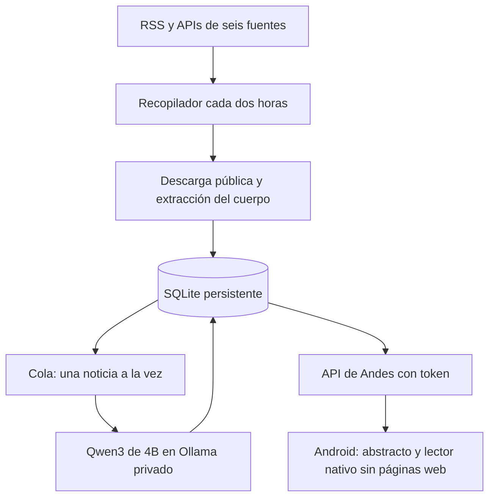

# Andes News

Android en Flutter y backend de noticias de desarrollo de software e IA para Perú y Latinoamérica. Backend 0.5.0 con Fastify 5 y APK 0.6: el servidor recopila fuentes cada dos horas, recupera el cuerpo de los artículos, genera abstractos en español y conserva una lectura limpia con texto original, imágenes, tablas y traducción cuando hace falta.

## Arquitectura

Integración opcional: [Horizon + Laya: configuración de diez tipos de fuente, despliegue y evaluación](docs/despliegue_horizon_laya.md), [arquitectura y protocolo de calidad](docs/integracion_horizon_laya.md) e [informe de validación](docs/validacion_horizon_laya.md). El modo predeterminado conserva las reglas actuales; la captura multifuente y clasificación local se habilitan con `compose.intelligence.yaml`.



La app no consulta las fuentes ni ejecuta inferencias. Obtiene noticias y artículos preparados mediante la API. Cambiar los filtros o deslizar el feed consulta el servidor; no inicia otra recopilación.

## Procesamiento

- Recopila Gestión Tecnología, Xataka México, Genbeta, GitHub Changelog, DEV en español y Hacker News. Inspecciona hasta 80 entradas RSS y selecciona hasta 20 noticias pertinentes por fuente en cada ciclo; Hacker News inspecciona hasta 40 historias.
- Filtra antes de gastar GPU: acepta ingeniería de software, herramientas para desarrolladores y avances/métodos/aplicaciones concretas de IA. Excluye lanzamientos de consumo, ofertas, entretenimiento y noticias genéricas; mencionar IA no basta. Un celular puede pasar si su titular/extracto aporta SDK, inferencia o herramientas para desarrolladores, y cumple el enfoque técnico.
- Revisa nuevamente la pertinencia con el cuerpo recuperado. El criterio es una política explícita por términos y contexto, no un clasificador de IA; puede omitir titulares ambiguos o aceptar algún falso positivo. Se conserva el motivo de selección en `relevance`.
- Deduplica por URL y conserva procedencia. Dentro de cada día da prioridad a noticias técnicas con referencias a Perú/Latinoamérica en su contenido; esas referencias no garantizan que describan una implantación regional real. Mantiene también avances globales relevantes.
- Descarga el HTML público, respeta `robots.txt` y extrae el cuerpo con Mozilla Readability. Elimina scripts, publicidad identificable, navegación y diálogos de cookies. No ejecuta JavaScript ni carga páginas dentro del lector.
- Para DEV obtiene el cuerpo publicado desde su API pública de artículos, en lugar de utilizar la descripción breve del listado.
- Guarda párrafos, títulos, listas, citas, código e imágenes del cuerpo con sus leyendas. Las tablas conservan encabezados y celdas combinadas y se muestran como cuadros con desplazamiento horizontal.
- Conserva archivos de video directos recuperables (MP4, WebM o streams compatibles con Android), con reproducción nativa bajo demanda. Los embeds de YouTube y Vimeo se convierten en enlaces a su reproductor externo; no se descargan ni se eliminan anuncios del proveedor. PDF, DRM, reproductores personalizados y contenido cargado exclusivamente mediante JavaScript pueden no recuperarse.
- Procesa **todas** las partes del texto recuperado con contexto de 2048 tokens. Combina notas de forma jerárquica y genera un abstracto de hasta 160 palabras y puntos clave. No usa el extracto del RSS para generar el abstracto.
- Traduce el titular y el cuerpo cuando el idioma detectado no es español. Traduce por bloques y conserva intactos los bloques de código. La app permite alternar español/original.
- Guarda resultados y caché de las inferencias en SQLite, en el volumen existente `andes-cache`. Conserva artículos y caché durante 60 días; recupera trabajos interrumpidos después de reiniciar.
- Descubrimiento e inferencia usan bucles separados: la consulta cada dos horas sigue funcionando aunque haya una cola de artículos pendientes. Las noticias se preparan progresivamente; no hay garantía de que toda una carga termine antes del siguiente ciclo.

`extracted` indica cuerpo recuperado por el extractor, no una garantía editorial de que la página entregó cada elemento del artículo. `partial` señala restricciones detectadas de la fuente. Los errores de acceso, robots, contenido insuficiente o formatos no soportados se registran; se reintenta hasta tres veces y nunca se inventa un artículo completo a partir del titular. Los abstractos y traducciones siguen siendo resultados de IA y pueden contener errores.

## Android

La versión 0.5 organiza Flutter por funcionalidades, con Riverpod, controladores MVVM, repositorios y modelos inmutables. Consulta [la arquitectura y guía de mantenimiento de Android](docs/flutter_architecture.md). La actualización conserva guardados, contenido en caché, fuentes y el token existente; no requiere actualizar el backend 0.4.3 ni cambiar sus credenciales.

El dominio predeterminado es `https://andes-news.cmaquera.com`. En Ajustes introduce tu token `ANDES_API_TOKEN`; la URL se puede cambiar. El token se almacena con Flutter Secure Storage y no está incluido en el APK.

El lector tiene Abstracto y Artículo limpio. El enlace original queda como acción secundaria explícita. Al guardar una noticia, intenta descargar su cuerpo; si no hay conexión o el servidor aún no lo preparó, conserva los datos disponibles. El contenido abierto se guarda en caché para lectura sin conexión.

Imágenes y videos se cargan directamente desde URLs HTTPS de la fuente, sin enviarles el token de Andes. Se necesita conexión para cargarlos; no se guardan sus archivos en la caché persistente de lectura. La fuente puede bloquearlos o caducar la URL: en ese caso se muestra un aviso. La extracción conserva elementos del cuerpo detectado, no una copia exacta de la página.

```powershell
flutter pub get
flutter analyze
flutter test
flutter build apk --release --target-platform android-arm64
```

El APK queda en `build/app/outputs/flutter-apk/app-release.apk`. Se firma con la clave de desarrollo para pruebas personales. Antes de distribuir en Play Store hace falta configurar una firma propia.

## Backend y despliegue

Sigue [server/DEPLOY.md](server/DEPLOY.md). Dokploy construye el backend Node.js 22 con sus dependencias desde `compose.yaml`. Mantén una sola instancia para compartir la cola y la base de datos con tu GPU.

La API usa Fastify 5, con rutas declaradas y parámetros validados mediante JSON Schema. `server/src/app.mjs` construye Fastify y `server/src/server.mjs` controla arranque y cierre. Las carpetas `config`, `routes`, `schemas`, `plugins`, `services`, `jobs` y `repositories` separan responsabilidades; `server/tests` contiene las pruebas y `server/scripts` las herramientas de diagnóstico. Consulta [la estructura y guía de mantenimiento](server/README.md). Las pruebas usan `fastify.inject()` y conexiones HTTP locales. El registro de solicitudes oculta el encabezado de autorización.

```dotenv
ANDES_API_TOKEN=TU_TOKEN_ALEATORIO
ANDES_PORT=8787
OLLAMA_SERVICE_HOST=host.docker.internal
OLLAMA_SERVICE_PORT=11434
```

El contenedor llega al Ollama existente en Ubuntu por la red privada de Docker, no por un dominio público. Usa `qwen3:4b-instruct-2507-q4_K_M`, cuatro hilos de CPU y una inferencia a la vez. No instala ni descarga otro modelo.

Para desarrollo local fuera de Docker configura el token y una ruta de SQLite dentro del proyecto antes de iniciar `npm.cmd start --prefix server` o `node server/src/server.mjs`. Ollama se busca por defecto en `127.0.0.1:11434`.

## API

- `GET /` y `GET /health`: estado básico sin credenciales.
- `GET /articles?limit=100&offset=0`: metadatos, abstractos preparados, estado de colección y cola.
- `GET /articles/:id`: cuerpo original y traducción, en bloques de texto.
- `GET /sources`: fuentes configuradas.
- `GET /status`: último ciclo, próximo ciclo y trabajos pendientes.

Estas rutas de datos requieren `Authorization: Bearer TOKEN`. `/summary` devuelve 410: la versión anterior resumía extractos y fue sustituida por el procesamiento de artículos en segundo plano. Es necesario actualizar backend y APK juntos.

El backend 0.4.3 reorganizado es compatible con el APK 0.4 ya instalado: redespliega únicamente el backend. La paginación acepta enteros `limit` entre 1 y 200 y `offset` entre 0 y 100000; valores fuera de esos rangos o inválidos devuelven 400. Los IDs inexistentes o inválidos devuelven 404 y los errores internos devuelven un mensaje genérico, sin información de la base de datos.

Para consultar el estado desde Ubuntu, sustituye únicamente `TU_API_KEY` por tu `ANDES_API_TOKEN`:

```bash
curl --fail-with-body -sS "https://andes-news.cmaquera.com/status" -H "Authorization: Bearer TU_API_KEY"
```

`collection` contiene el último ciclo y sus errores; `nextCollectionAt` es la próxima ejecución en milisegundos Unix, `counts` indica noticias por estado y `processing` indica si el trabajador está ocupado. La actualización 0.4 vuelve a poner una sola vez en la cola los artículos de texto de 0.3 para recuperar imágenes, tablas y videos. Conserva su lectura anterior y abstracto mientras espera; no elimina la base de datos.

El backend 0.4.1 aplica el enfoque también a las noticias ya guardadas al iniciar: las irrelevantes salen del feed y de la cola con estado `filtered`, conservando su detalle para artículos guardados. `collection.filtered` cuenta candidatos descartados en el ciclo; `counts.filtered` cuenta artículos guardados descartados. El APK 0.4 ya instalado es compatible; basta redesplegar el backend y actualizar el feed.

Las solicitudes a publicaciones se limitan a HTTP/HTTPS público con DNS comprobado y fijado a la conexión. Se rechazan direcciones privadas, redirecciones inseguras, HTML de más de 2 MB y documentos de más de 30000 elementos. Ollama es la única conexión interna intencionada.

## Verificación

```powershell
npm.cmd ci --prefix server --ignore-scripts
npm.cmd test --prefix server
npm.cmd run format:check --prefix server
flutter analyze
flutter test
```

Las pruebas cubren extracción limpia, contenido parcial, robots, bloqueo de direcciones privadas, procesamiento de todas las partes, persistencia/reanudación, recopilación cada dos horas durante inferencia, exclusión de trabajadores concurrentes, autenticación y lector original/traducido en pantalla pequeña.

La extracción real se comprobó con un artículo de Genbeta de 509 palabras y tres imágenes y un changelog de GitHub de 428 palabras. Las pruebas cubren además conservación/traducción de tablas con celdas combinadas, metadatos de videos y renderizado de tablas en pantalla pequeña. Las pruebas automáticas de inferencia usan respuestas simuladas; el procesamiento completo con tu GPU, la reproducción de videos en un teléfono físico y el nuevo despliegue en Dokploy deben verificarse al desplegar. No hay motor Docker activo en el entorno de desarrollo para construir localmente la imagen; el Compose sí se validó.

## Diseño y atribución

Interfaz adaptada de [TrendSpot News App](https://www.figma.com/community/file/1339560523860969699/trendspot-news-app), de [Hameed Shah](https://www.figma.com/@hameedshah), bajo [CC BY 4.0](https://creativecommons.org/licenses/by/4.0/). Se modificaron marca, textos, navegación, fuentes y lector. La atribución también aparece en Ajustes. No se copiaron fotografías de ejemplo.

Referencias: [Mozilla Readability](https://github.com/mozilla/readability), [API de Ollama](https://docs.ollama.com/api/generate), [API de Hacker News](https://github.com/HackerNews/API), [Forem API](https://developers.forem.com/api/v1).
