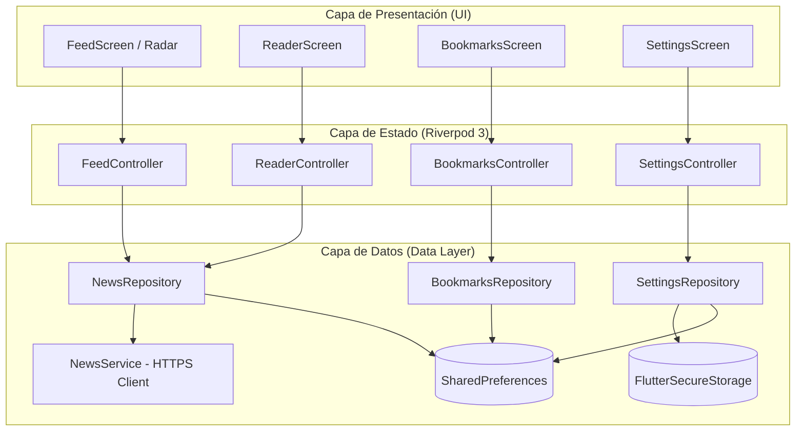

# Arquitectura de la Aplicación Android

Andes News 0.6.5 (Build 11) implementa el patrón de arquitectura MVVM modular impulsado por Riverpod 3 (`NotifierProvider`), prescindiendo de generación de código en tiempo de compilación.

Los widgets son responsables únicamente de renderizar la interfaz de usuario, responder a interacciones visuales, gestionar animaciones locales y coordinar la navegación. Toda la lógica de negocio, orquestación de operaciones asíncronas, sincronización en red y mutaciones de estado se encapsulan en controladores que exponen estados inmutables.

---

## Estructura de Directorios

```text
lib/
├── main.dart                  # Punto de arranque y compatibilidad de herramientas
├── app/
│   ├── andes_app.dart         # Configuración de MaterialApp y ProviderScope
│   ├── providers.dart         # Inyección de dependencias y propiedad de clientes
│   └── theme.dart             # Paleta Cyber-Obsidian, tipografías y estilos
├── core/
│   ├── errors/                # Tipado explícito de excepciones y fallos de red
│   ├── network/               # Cliente HTTP autenticado con Bearer Token
│   ├── storage/               # Capa de almacenamiento local y caché offline
│   └── ui/                    # Componentes compartidos, iconos vectoriales y botones
├── data/
│   ├── models/                # Modelos inmutables (Article, NewsSource, ContentBlock)
│   └── repositories/          # Repositorios de noticias, ajustes y guardados
└── features/
    ├── feed/                  # Pantalla de Radar (feed principal) y selector de canales
    ├── reader/                # Pantalla de lectura limpia, abstractos y visor multimedia
    ├── bookmarks/             # Pantalla de artículos guardados para consulta offline
    └── settings/              # Pantalla de Ajustes y administración de Canales
```

---

## Flujo de Datos y Capas



### 1. Modelos de Dominio Inmutables
- `NewsArticle`: Metadatos del artículo (id, título, resumen/abstracto, procedencia, categoría, fecha de publicación, puntuación de relevancia, estado de lectura y guardado).
- `NewsSource`: Representación de canal o fuente con campos `id`, `name`, `description`, `count` y `isEnabled`.
- `ArticleContent`: Contenedor del contenido completo del artículo, soportando visualización en español y texto original.
- `ContentBlock`: Elementos de bloque desacoplados (párrafos de texto, encabezados de secciones, bloques de código monospace, citas en bloque, imágenes con pie explicativo, tablas estructuradas con celdas y enlaces multimedia directos).

### 2. Repositorios y Servicios
- `NewsService`: Encargado de la comunicación HTTP directa con la API de Andes (`https://andes-news.cmaquera.com`). Maneja inyección de cabeceras de autorización `Bearer <token>`, validación de códigos de respuesta HTTP y parseo de errores de red estructurados.
- `NewsRepository`: Orquesta la obtención del feed, la recuperación de canales dinámicos y la lectura de artículos individuales. Gestiona la caché en `SharedPreferences` para soportar navegación fluida sin conexión.
- `SettingsRepository`: Administra la persistencia de las preferencias del usuario, la URL base del endpoint y las credenciales cifradas con `FlutterSecureStorage`.
- `BookmarksRepository`: Coordina el almacenamiento persistente de artículos guardados por el usuario, descargando el cuerpo completo para lectura garantizada sin conectividad.

---

## Sistema Dinámico de Canales (v0.6.5)

El sistema de canales resuelve la representación y control granular de las 22 fuentes técnicas configuradas en el backend:

1. **Agrupación en Origen**: El endpoint `GET /sources` consolida las fuentes en categorías o canales técnicos de alto nivel (por ejemplo: Blogs y Feeds RSS, Medios y Portales Tech, Ecosistema Open Source, Comunidades de Desarrolladores, Plataformas de Discusión).
2. **Metadatos Enriquecidos**: Cada canal incluye su conteo exacto de fuentes subyacentes (`count`) y una descripción concisa de su cobertura técnica (`description`).
3. **Formato Visual**: En la pantalla de Ajustes, cada canal se presenta con el formato `[Nombre Canal] (X fuentes)` y subtítulo explicativo, utilizando switches estilizados según el sistema Cyber-Obsidian.
4. **Filtrado No Destructivo**: La activación o desactivación de un canal en Ajustes no interrumpe la sincronización global en segundo plano ni elimina las noticias del almacenamiento local; simplemente ajusta el predicado de visibilidad en los controladores de presentación (`FeedController`).

---

## Concurrencia, Errores y Modo Offline

- **Deduplicación de Solicitudes**: Las peticiones simultáneas de actualización del feed comparten la misma tarea en ejecución si no han variado las credenciales ni el endpoint.
- **Tolerancia a Fallos**: Si el servidor no responde o hay pérdida de cobertura móvil, la aplicación recurre automáticamente al contenido previamente indexado en la caché local.
- **Tipado Estricto de Excepciones**: Los errores de conexión diferencian claramente fallos de autenticación (HTTP 401/403), endpoints mal configurados (HTTP 404), respuestas del servidor (HTTP 500/502/503) y problemas de conectividad local (DNS, timeouts).
- **Carga Progresiva de Recursos**: Los bloques multimedia pesados y tablas complejas del lector se inicializan bajo demanda a medida que entran en el viewport (`ListView.builder`).

---

## Verificación y Calidad de Código

### Suite de Comprobaciones Previas
```powershell
flutter pub get
dart format --output=none --set-exit-if-changed lib test integration_test
flutter analyze
flutter test
```

### Pruebas Automatizadas
- `test/architecture_test.dart`: Evalúa la inmutabilidad de los modelos, la propagación de errores de API, la gestión de dependencias y la resiliencia ante estados corruptos de almacenamiento local.
- `test/app_flow_test.dart`: Simula el recorrido de usuario completo (Radar → Lector limpio → Alternancia de idioma → Guardado de artículo → Ajustes y Canales) utilizando dobles de prueba sin invocar servicios de red externos.
- `test/article_media_test.dart`: Verifica la extracción y formato de bloques multimedia, tablas con celdas combinadas y bloques de código.
- `test/ui_test.dart` y `test/preview_test.dart`: Aseguran la coherencia visual de los componentes, chips de selección y estados de los botones.

### Pruebas de Integración en Dispositivo Real
Para ejecutar la suite de integración en un terminal Android conectado mediante depuración USB:

```powershell
flutter test integration_test/app_flow_test.dart -d <DEVICE_ID>
```

---

## Integración Continua (CI)

El flujo `.github/workflows/quality.yml` se ejecuta automáticamente ante cada push a la rama `main` y pull requests:
- Validación de formato Dart con `dart format`.
- Análisis estático estricto con `flutter analyze`.
- Ejecución completa de la suite de pruebas unitarias y de widgets con `flutter test`.
