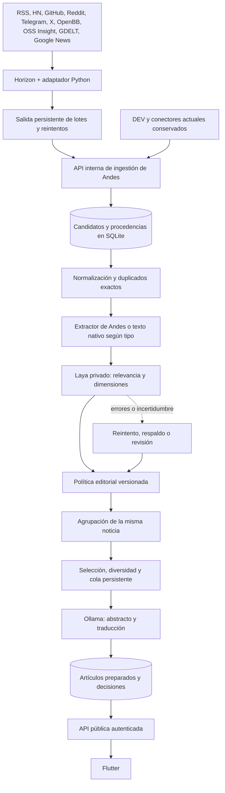

# Andes News + Horizon + Laya: análisis, arquitectura y validación

Fecha: 18 de octubre de 2026. Documento de diseño y protocolo de evaluación. El desarrollo comenzó después de esta propuesta: consultar [la implementación y despliegue](despliegue_horizon_laya.md) y [la validación](validacion_horizon_laya.md) para conocer el estado real. Las metas de calidad siguen siendo criterios del piloto, no resultados medidos.

## 1. Decisión recomendada

Conservar Andes como producto, API, repositorio y lector; incorporar Horizon mediante un trabajador Python para ampliar la captura; ejecutar Laya en Ubuntu como servicio privado de decisiones. Mantener Ollama/Qwen para resumir y traducir contenido recuperado. Evaluar las tres piezas por separado antes de activar el filtrado nuevo.

La hipótesis a probar es que Laya permite reconocer contenido técnico útil y priorizarlo con menos inferencia generativa, mientras Horizon aumenta la cobertura. Más fuentes por sí solas no garantizan un feed mejor. La calidad se medirá con etiquetas humanas y comparación contra el sistema actual.

| Componente | Responsabilidad propuesta | Límite |
| --- | --- | --- |
| Andes/Fastify | Identidad de artículos, contenido, selección publicada, persistencia, autenticación y API móvil | Único escritor de su SQLite |
| Horizon + adaptador Python | Captura multifuente y normalización; referencia experimental para puntuación y agrupación | Sus modelos y salidas necesitan traducción al contrato de Andes |
| Laya privado | Clasificación, relevancia, profundidad técnica y otras decisiones estructuradas | No genera resúmenes, traducciones ni verifica la verdad de una noticia |
| Ollama existente | Abstractos y traducciones; arbitraje opcional de casos ambiguos | Presupuesto de GPU y concurrencia compartido |
| Flutter | Fuentes dinámicas, razones de selección, lectura y evaluación del usuario | Sigue sin ejecutar modelos ni recopilar fuentes |

La documentación primaria de [Laya](https://github.com/NandhaKishorM/laya) describe decisiones `choice`, `score` y `noul`. No es un reemplazo directo de un endpoint generativo de chat. [Horizon](https://github.com/Thysrael/Horizon) ofrece un flujo editorial con perfiles, puntuación y resúmenes. Conectar Horizon a Laya requiere código de adaptación; cambiar solamente `ai.base_url` no resuelve esa integración.

## 2. Diagnóstico del código actual

| Evidencia local | Comportamiento observado | Cambio necesario |
| --- | --- | --- |
| `server/src/config/sources.mjs` y `services/sources.mjs` | Seis fuentes; RSS, DEV y HN; GitHub actual es el RSS de Changelog | Incorporar releases, comunidades y canales sin sustituir DEV |
| `server/src/jobs/collector.mjs` | Descubre cada dos horas y prepara artículos en un bucle separado; filtra antes y después de extraer | Insertar evaluación editorial antes de resumir y conservar candidatos para comparar |
| `server/src/services/focus.mjs` | Política de términos, prioridad regional y tema | Utilizar como línea base y respaldo; impedir que sus descartes oculten casos a Laya durante el piloto |
| `server/src/repositories/sqlite_store.mjs` | ID derivado de URL, URL única, cola y caché; retención de 60 días | Separar documentos, apariciones en fuentes, decisiones y grupos de noticias |
| `Store.discover()` | Al encontrar la misma URL devuelve el artículo existente sin incorporar la nueva aparición | Registrar cada procedencia y discusión en una relación aparte |
| `Store.list()` | Orden por día, prioridad y región; publica también pendientes aceptados | Añadir una vista editorial de contenido preparado y puntuación, activable por modo |
| `server/src/services/article_extractor.mjs` | Extractor web con bloques ricos | Evitar tratar mensajes sociales y releases como páginas periodísticas |
| `server/src/services/ollama.mjs` | Resumen por partes, traducción y caché; contexto configurado en 2048 | Reutilizar, versionar nuevos prompts y medir coste por longitud |
| `lib/data/models/article.dart` | `score` es entero y representa interacción; catálogo fijo de fuentes | Añadir `editorialScore` separado, tipos de contenido y catálogo remoto |
| `lib/data/repositories/news_repository.dart` y `core/network/news_service.dart` | Carga el feed usando IDs del catálogo fijo y descarta otros | Resolver fuentes desde `/sources`, con caché y migración de preferencias |
| `compose.yaml` | Una API con límite de 768 MB, SQLite y acceso al Ollama del host | Servicios independientes con límites propios; no cargar PyTorch en el contenedor Node |

Hay filtrado adicional de HN dentro de `loadSource()`: modificar solo el filtro del recopilador no permitiría evaluar todos los titulares ambiguos. El piloto debe tomar candidatos anteriores a ambos descartes editoriales. La validación de red y los límites de contenido sí se mantienen.

La prioridad regional actual detecta menciones; no demuestra una aplicación real en Perú o Latinoamérica. La nueva rúbrica distinguirá una mención incidental de una relación sustantiva con evidencia textual.

## 3. Capacidades y restricciones verificadas

| Fuente | Integración disponible en Horizon | Estrategia inicial |
| --- | --- | --- |
| RSS/Atom | Feeds configurables | Comparar primero feeds ya usados por Andes |
| Hacker News | Historias y comentarios | Conservar el enlace de discusión y el destino editorial por separado |
| GitHub | Eventos públicos y releases de repositorios | Empezar por releases; una estrella no demuestra calidad técnica |
| Telegram | Vista web de canales públicos | Probar canales concretos; no supone acceso a grupos privados |
| Reddit | Captura pública con alternativas HTML/JSON/RSS | Comprobar disponibilidad desde Ubuntu y degradar por fuente ante bloqueos |
| X | Apify y una alternativa Playwright | Incorporar después del piloto básico y con presupuesto; búsquedas por palabras requieren el modo Apify según el código/documentación revisados |
| OpenBB | Noticias de empresas por watchlist/proveedor | Empresas de software/IA; configurar proveedor, símbolos y dependencias opcionales |
| OSS Insight | Repositorios con aumento de estrellas | Descubrimiento de proyectos; validar utilidad técnica sin confundir estrellas con calidad |
| GDELT | Noticias mediante consulta | Consultas sobre software/IA; verificar pertinencia regional con el contenido |
| Google News | Búsqueda mediante RSS | Consultas en español y país configurable; comprobar disponibilidad y robots |

El alcance confirmado incluye **los diez tipos de fuente**. Se mantiene el enfoque en software, IA y empresas relacionadas; OpenBB no introduce finanzas generales. La selección concreta de feeds, usuarios, subreddits, canales, repositorios y empresas forma parte de la configuración del piloto.

Referencias: [scrapers](https://github.com/Thysrael/Horizon/blob/main/docs/scrapers.md), [configuración](https://github.com/Thysrael/Horizon/blob/main/docs/configuration.md). En X, la cantidad solicitada por ejecución de Apify puede superar un `fetch_limit` pequeño; medir consumo real. No se asume captura gratuita ni continua de todas las plataformas.

Horizon puntúa mediante perfiles y puede agrupar temas dentro de cada perfil, antes de enriquecer. Su análisis incluye texto generado: motivo, resumen y etiquetas. Laya no produce esos campos. Por eso el adaptador no fingirá que una respuesta de Laya es un `ContentAnalysis` completo. Guardará una evaluación propia y generará motivos visibles mediante plantillas basadas en dimensiones y evidencias. Véanse [puntuación](https://github.com/Thysrael/Horizon/blob/main/docs/scoring.md) y [modelo de datos](https://github.com/Thysrael/Horizon/blob/main/src/models.py).

Horizon exige Python 3.11 o superior en su [pyproject](https://github.com/Thysrael/Horizon/blob/main/pyproject.toml). Usar Python 3.12 como candidato de construcción y resolver/fijar dependencias en imágenes separadas. La guía de instalación facilitada para Laya es un recurso comunitario; para contratos de ejecución se tomó también el repositorio del autor.

## 4. Arquitectura propuesta



### 4.1 Adaptador de Horizon

Un contenedor Python ejecuta la captura cada dos horas inicialmente, con bloqueo que evita ejecuciones solapadas. Usa las etapas de captura de Horizon, fijadas a un commit revisado; no analiza Markdown para reconstruir artículos. El código de [orquestación](https://github.com/Thysrael/Horizon/blob/main/src/orchestrator.py) expone etapas de captura y procesamiento, pero son una dependencia que debe cubrirse con pruebas de contrato.

El adaptador transforma `ContentItem` a un sobre propio. Propuesta de campos:

```json
{
  "schemaVersion": 1,
  "batchId": "uuid-de-ejecucion",
  "producerRevision": "commit-fijado-de-horizon",
  "items": [{
    "sourceInstanceId": "github:repo:python/cpython",
    "sourceType": "github",
    "externalId": "identificador-nativo",
    "contentKind": "release",
    "sourceUrl": "https://github.com/python/cpython/releases/tag/vX",
    "targetUrl": null,
    "title": "Título de la publicación",
    "nativeText": "Texto recuperado, sin completar con IA",
    "publishedAt": "2026-10-18T10:00:00Z",
    "fetchedAt": "2026-10-18T10:05:00Z",
    "languageHint": "en",
    "engagement": {"score": 0, "comments": 0}
  }]
}
```

Endpoint propuesto: `POST /internal/ingestion/batches`, solo en listener/red interna con token de servicio distinto al token móvil. Validar esquema, fuentes permitidas, tamaños y URLs; responder por elemento con aceptado, repetido o rechazado. Límites iniciales propuestos: 50 elementos por lote, 32 KB de texto por elemento y 2 MB por petición, ajustables según medición.

Reintentos conservan `batchId`; una aparición se identifica por `(sourceInstanceId, externalId)` y una revisión por hash de contenido. El adaptador mantiene una salida pendiente en volumen propio hasta recibir confirmación; los errores transitorios reintentan con espera creciente. Un lote con errores parciales no confirma los elementos fallidos como entregados. Ningún proceso Python abre `andes.db`.

Los conectores de Andes usarán el mismo servicio interno de ingreso mediante llamada local en Node. Durante la comparación se permiten ambos productores con idempotencia; al promover una fuente se le asigna un único propietario de captura. DEV sigue en Andes hasta disponer de un reemplazo verificado.

### 4.2 Laya privado en Ubuntu

Usar el servicio HTTP del proyecto, `POST /v1/systemone`, con cliente pequeño de Andes y validación de respuesta. Mantener contrato nativo separado de los endpoints de Ollama. El [servidor de Laya](https://github.com/NandhaKishorM/laya/blob/main/laya/serve.py) documenta autenticación Bearer opcional y variables para modelos, hilos y concurrencia.

Primera variante: CPU y checkpoint multilingüe explícito para los candidatos en español/inglés, evitando competir con Qwen por VRAM. Precargar solo el modelo elegido y probar una inferencia real para readiness. `LAYA_MODELS` configura precarga; por sí sola no garantiza que el enrutador nunca cargue otro modelo. El cliente enviará el modelo explícito y se comprobará el consumo real.

Fijar paquete, revisión de pesos, imagen y rúbrica. Un punto de partida documentado es Laya 0.4.11; confirmar que la revisión de código utilizada corresponde a la distribución antes de construir. No desplegar automáticamente `main` ni descargar todos los checkpoints por defecto.

La [guía Docker primaria](https://github.com/NandhaKishorM/laya/blob/main/docs/docker.md) pide permitir 8 GB de RAM y 10 GB de disco para su quickstart CPU. Es una orientación del quickstart, no una medición del servicio propuesto ni del conjunto Andes + Ollama. Inventariar Ubuntu y medir pico de RAM, disco y concurrencia antes de fijar límites. GPU será una segunda variante, condicionada a compatibilidad de tarjeta/driver y VRAM libre.

Los textos largos se segmentan por tokens reales y conservan las evidencias y offsets. Evaluar ventanas de título, inicio, centro y final para clasificación; casos contradictorios o sin evidencia suficiente pasan a revisión o a lectura más amplia. El resumen conserva el procesamiento de todo el cuerpo recuperado que ya hace Andes. Registrar qué partes vio cada modelo evita presentar una decisión parcial como lectura completa.

### 4.3 Selección editorial

Dimensiones propuestas: relevancia para software/IA, profundidad técnica, evidencia concreta, utilidad práctica, novedad respecto al archivo y relación regional sustantiva. Las señales sociales se mantienen separadas y no se comparan directamente entre plataformas.

`editorialScore = 10 × (0.30R + 0.25T + 0.20E + 0.15U + 0.10N)`, con dimensiones normalizadas entre 0 y 1. Pesos iniciales para calibrar, no una fórmula validada. `N` combina comparación con el archivo y señales editoriales; un modelo sobre un solo texto no puede establecer por sí mismo la novedad histórica. La calidad/evidencia estimada tampoco certifica veracidad.

Elegibilidad requiere foco pertinente y contenido suficiente; después se aplican score y diversidad. Umbral exploratorio: 7/10. La incertidumbre tiene un umbral diferente, a calibrar sobre datos separados. Guardar probabilidades por dimensión; una concentración alta de respuestas no equivale a precisión demostrada. Las métricas de confianza de Laya tienen semánticas distintas: seleccionar el campo apropiado para cada tipo y validarlo, sin copiar umbrales entre modelos.

No descartar automáticamente candidatos con poca confianza, contexto truncado, idioma incierto o error de modelo. Pasan a `review` o reintento; un respaldo explícito puede aplicar las reglas actuales, marcado como degradado. En modo sombra los nuevos resultados no alteran el feed. En modo activo un fallo conserva artículos publicados y no transforma un timeout en rechazo editorial.

Empezar con perfiles Andes `software`, `ai-applied` y `security`, adaptando la estructura de [perfiles de Horizon](https://github.com/Thysrael/Horizon/blob/main/docs/profiles.md). Evitar que las cuotas por tema oculten todas las noticias regionales pertinentes o mezclen incidentes críticos con tutoriales. Mantener una selección por ventana y, opcionalmente, un digest diario de hasta 20 entradas, sin completar cupos con contenido de baja calidad.

### 4.4 Deduplicación sin perder información

1. Identidad de aparición por fuente e ID nativo.
2. URL canónica y destino resuelto con la protección de red de Andes. Conservar parámetros semánticos; eliminar solo rastreadores conocidos.
3. Hash de texto normalizado para copias exactas con URLs distintas.
4. Candidatos de agrupación por entidades, producto, versión y cercanía temporal. Probar similitud léxica primero; añadir embeddings solo si el corpus lo justifica.
5. Arbitraje semántico opcional sobre un conjunto acotado de pares. Comparar la etapa de Horizon con pares evaluados por Laya u Ollama. No asumir que Laya incorpora un deduplicador listo para Andes.

El criterio es «mismo hecho sin aporte distinto», no «mismo tema». Un lanzamiento, una corrección de seguridad y un tutorial de ese producto pueden ser lecturas diferentes. Conservar todas las procedencias y comentarios separados del cuerpo periodístico. Agrupar mediante `clusterId`, sin borrar artículos ni cambiar IDs de guardados. Validar contra una ventana inicial de 72 horas y permitir excepciones por versión/evento.

Horizon agrupa temas dentro de perfiles; la deduplicación persistente entre ciclos y perfiles de Andes necesita una capa propia. Un fallo de agrupación deja entradas separadas y queda registrado.

### 4.5 Persistencia y contrato móvil

Migraciones aditivas propuestas, ejecutadas por Andes con versión y transacción:

| Entidad | Información |
| --- | --- |
| `source_instances` | Fuente concreta, tipo, propietario, estado y configuración no secreta |
| `ingestion_batches` / `source_occurrences` | Entrega idempotente, ID nativo, URLs, tiempos, hash y vínculo al artículo |
| `candidate_documents` | Texto normalizado, tipo, cobertura y revisión; permite analizar descartados |
| `editorial_decisions` | Dimensiones, score, evidencias, incertidumbre, modelo/pesos/rúbrica y duración |
| `story_clusters` / `cluster_members` | Agrupaciones reversibles y representante |
| `pipeline_jobs` | Etapa, estado, intentos, próximo reintento y lease de recuperación |
| `pipeline_runs` | Conteos por fuente/etapa, tiempos, errores y modo experimental |

Conservar `articles` y los IDs actuales. Dos apariciones de una URL deben enriquecer procedencia sin generar dos resúmenes. Mantener `score` entero de interacción y añadir `editorialScore` numérico, `contentKind`, `editorialStatus`, `clusterId`, `selectionReasons`, `sourceOccurrences` y `evaluationVersion` como campos opcionales.

Separar estado técnico (`queued`, `processing`, `ready`, `unavailable`) de editorial (`pending`, `accepted`, `rejected`, `review`, `duplicate`). Un artículo listo puede perder prioridad sin perder su detalle. Cachés nuevas incluyen hash de contenido, paquete/modelo/revisión de pesos, idioma, rúbrica y presupuesto de contexto. Cambiar un umbral puede recalcular política sin repetir inferencias si la evaluación sigue siendo válida.

API propuesta: ampliar `/sources` y `/status`; añadir selección explícita en `/articles` y un endpoint interno de resultados experimentales. Los endpoints internos deben quedar fuera del proxy público, además de autenticados. El APK actual permanece en modo compatible con fuentes antiguas; la nueva vista y las nuevas fuentes se habilitan al actualizar Flutter.

Flutter debe persistir el catálogo remoto y las preferencias por ID estable, cargarlo al iniciar/actualizar y definir cómo activar fuentes nuevas. Mostrar tipo, procedencia, motivo breve y coberturas relacionadas. Para `social_post`, `discussion` y `release`, renderizar el texto nativo y su atribución; un extracto RSS no pasa a ser «artículo completo». Los artículos web siguen usando el extractor rico de Andes. Preservar guardados, caché y lectura sin conexión; incorporar paginación antes de ampliar mucho el volumen, pues hoy el cliente pide solo 200 entradas.

### 4.6 Operación y límites de confianza

Compose mantendrá API, trabajador Horizon y Laya como servicios distintos, con volúmenes separados. Solo la API de producto se publica mediante el dominio existente. Mantener acceso privado al Ollama del host y una sola instancia escritora de Andes.

Los scrapers introducen otra ruta de red: no heredan automáticamente las protecciones SSRF, DNS y robots de Node. Revisar cada conector, restringir destinos/redirects y bloquear acceso a redes privadas y metadatos desde el trabajador; usar pruebas con un proxy controlado. No cargar cookies o credenciales de redes en la app. Validar URLs multimedia y enlaces antes de exponerlos.

Propuesta operativa: captura cada dos horas con ventana solapada de 24 horas e idempotencia; respetar límites de cada fuente y registrar vacíos distintos de fallos. Concurrencia inicial de inferencia 1. Si la prueba Horizon usa Ollama, serializar sus llamadas con las de Andes mediante un coordinador/cola común o ejecutar el experimento en ventanas sin trabajador generativo de Andes. Dos clientes con límite individual de 1 aún pueden competir por la GPU.

Retención propuesta: contenido y decisiones 60 días, muestras etiquetadas anonimizadas y manifiestos de evaluación conservados para reproducibilidad. Aplicar cuotas al texto social y comentarios. Incluir respaldo/restauración consistente de SQLite, volúmenes nuevos y manifiestos de modelos. La eliminación de datos no puede dejar referencias rotas en grupos o trabajos.

## 5. Plan de implementación

Estimación inicial de la propuesta: 14–22 días de trabajo más 7–14 días de observación. La incorporación de las diez fuentes añade configuración y validación de proveedores; el avance real se documenta por entregables y evidencia, no por esta estimación inicial.

| Fase | Trabajo y archivos previstos | Entrega y condición de salida | Estimación |
| --- | --- | --- | --- |
| 0. Línea base | Inventario de Ubuntu, corpus y `docs/evaluation/`; medición del flujo actual | Hardware registrado, política de etiquetas y reporte base reproducible | 2 días |
| 1. Laya aislado | `services/laya/`, imagen fijada, cliente `server/src/services/laya.mjs`, smoke y benchmark | CPU operativa, modelo real identificado, respuestas válidas y medidas frías/calientes | 1–2 días |
| 2. Captura Horizon | `services/horizon_bridge/`, esquema, salida persistente; rutas/esquemas/repositorios de ingestión | RSS/HN/GitHub entregados con reintentos e idempotencia; DEV sigue funcionando | 3–4 días |
| 3. Política y grupos | Servicios editoriales, migraciones, jobs, evaluación y agrupación | Resultados A/B/C en sombra, procedencias completas, pruebas de falsas fusiones | 3–5 días |
| 4. Redes y móvil | Telegram/Reddit y luego X; catálogo, modelos, feed/lector/ajustes Flutter | Fuentes visibles y lectura correcta por tipo; presupuesto de X verificado | 3–5 días |
| 4b. Descubrimiento y empresas | OpenBB, OSS Insight, GDELT y Google News; selección de proveedores, empresas y consultas | Captura verificada por conector y descarte de finanzas genéricas; bloqueos registrados | 3–6 días orientativos |
| 5. Piloto y promoción | Compose, `server/DEPLOY.md`, flags, panel/reporte y restauración | Pruebas completas, observación y criterios de calidad/capacidad satisfechos | 2–4 días + observación |

Flags propuestos, aún no implementados: `INGESTION_MODE=legacy|shadow|active`, `EDITORIAL_MODE=rules|shadow|laya` y `SEMANTIC_DEDUP_MODE=off|shadow|active`. Documentar combinaciones válidas. Desactivar un modelo no reejecuta automáticamente todo el archivo ni borra decisiones.

Orden del piloto: fuentes actuales y releases; OSS Insight/GDELT/Google News; canales públicos y subreddits; OpenBB por empresas relacionadas y X con presupuesto. Los diez conectores permanecen en el alcance aunque su activación sea gradual.

## 6. Validación de calidad y resultados esperados

### 6.1 Diseño del experimento

Comparar sobre la misma captura congelada:

- A: reglas actuales + URL canónica + Ollama actual.
- B: perfiles de Horizon + Ollama, con adaptación de salida para la evaluación.
- C: captura Horizon + política Laya + agrupación + Ollama para contenido seleccionado.

En las fuentes nuevas A sirve como referencia de política aplicada a candidatos normalizados, no como evidencia de que el conector antiguo ya las soportaba. Medir también A sobre las seis fuentes actuales para conservar la comparación real. Comparar B/C con y sin agrupación permite atribuir cada mejora.

Corpus inicial: al menos 600 publicaciones diversas, ES/EN y los diez tipos de fuente cuando estén disponibles, con 100 historias agrupadas y al menos 150 pares positivos/negativos de deduplicación. No forzar muestras de fuentes aún inaccesibles: registrar la cobertura faltante. Incluir títulos ambiguos, promociones, noticias técnicas regionales, citas negadas, versiones distintas, republicaciones, finanzas genéricas y artículos con cuerpo no recuperable.

Etiquetas: pertinente, merece lectura, valor 0–3, tipo, relación regional, grupo de hecho y evidencia. Dos revisores etiquetan al menos 20%; desacuerdos se adjudican. Si solo hay un revisor, registrar esa limitación. Separación temporal 60/20/20 para desarrollo, calibración y prueba; todos los duplicados del mismo hecho quedan en una sola partición. Bloquear umbrales antes de abrir la partición final.

No usar el mismo LLM como único juez de la calidad del filtro. Guardar entradas, etiquetas, versiones, decisiones y tiempos; reportar por idioma/fuente y con intervalos de confianza. Una muestra de 600 es un punto de partida y puede resultar insuficiente para conclusiones por subgrupo.

### 6.2 Criterios de promoción propuestos

| Métrica | Definición | Meta del piloto, pendiente de medir |
| --- | --- | --- |
| Precisión editorial | Fracción de publicados que el revisor considera valiosos | ≥85% y mejora de ≥10 puntos porcentuales sobre A; si A ya supera 85%, exigir no regresión y ventaja medible de cobertura/coste |
| Recuperación | Valiosos retenidos / todos los valiosos del corpus | ≥90%; incluir descartados y revisión, no evaluar solo lo publicado |
| Ranking | nDCG@20 con etiquetas humanas 0–3 | Superar A; publicar resultado por día y agregado |
| Duplicados en selección | Repeticiones del mismo hecho / publicaciones seleccionadas | ≤5% y reducción ≥70% frente a A si el volumen base permite estimarlo |
| Falsas fusiones | Pares distintos fusionados / pares fusionados | ≤2%; si no hay suficientes pares, ampliar muestra antes de concluir |
| Cobertura regional | Valiosos regionales retenidos / valiosos regionales etiquetados | ≥90% y sin regresión frente a A |
| Preparación | Tiempo desde captura hasta disponibilidad de selección | p95 <2 horas en la carga piloto, medido también por longitud/tipo |
| Laya | Latencia caliente por candidato, con esquema y tamaño fijados | Objetivo inicial p95 ≤2 s en CPU; recalibrar alcance si Ubuntu no lo permite |
| API | Latencia de feed durante captura e inferencia | p95 <500 ms en LAN y sin regresión >20% frente a su base equivalente |
| Carga | Candidatos pendientes y tiempo generativo por contenido publicado | Cola estable durante 7 días; objetivo ≥30% menos tiempo generativo en C frente a B |
| Trazabilidad | Publicados con fuente, contenido base y revisión de evaluación | 100% |
| Fidelidad | Afirmaciones verificables del abstracto sustentadas en el contenido | ≥95% en auditoría; ningún error crítico detectado en la muestra |

Un umbral aislado no basta: aumentar precisión destruyendo recuperación no cumple el objetivo. Si la base ya tiene pocos duplicados, reportar valores absolutos y evitar porcentajes de mejora engañosos. Las metas de latencia y ahorro son hipótesis de capacidad, no benchmarks de Laya trasladados al servidor del usuario.

### 6.3 Pruebas técnicas y evidencia exigida

| Prueba | Resultado esperado | Evidencia |
| --- | --- | --- |
| Mismo lote enviado 3 veces | Una aparición por ID y una sola tarea efectiva | Conteos y claves únicas |
| Misma URL en RSS, HN y Telegram | Un documento con tres apariciones y discusión separada | Consulta de relaciones y detalle API |
| Mismo tema, versiones diferentes | Permanecen documentos distintos; agrupación solo si corresponde al mismo hecho | Corpus de pares y decisiones |
| Proceso interrumpido antes/después de confirmar entrega | Reintento sin pérdida ni resumen duplicado | Ensayo de reinicio con reconciliación |
| Laya caído, timeout o salida inválida | Error registrado; revisión/respaldo explícito; feed publicado disponible | Pruebas de fallos y estado por etapa |
| Fuente bloqueada o limitada | Solo esa fuente falla; espera creciente y diagnóstico | Registro por fuente sin credenciales |
| Texto de Telegram y release GitHub | Lectura nativa con tipo/atribución, sin forzar Readability | Prueba API + widget + dispositivo |
| RSS con extracción fallida | No presenta extracto como cuerpo completo | Cobertura y estado visibles |
| Cambia rúbrica o pesos | Invalida evaluación correspondiente sin alterar IDs | Prueba de caché y revaluación |
| Publicación con instrucciones maliciosas | No cambia política ni provoca acciones o acceso interno | Casos de prompt injection y SSRF |
| APK nuevo, guardados antiguos, fuente nueva y offline | Catálogo cacheado, preferencias preservadas y lectura existente disponible | Pruebas Flutter y dispositivo |
| Migración y reversión | Datos anteriores recuperables; servicio vuelve al modo base | Respaldo restaurado en entorno de prueba |

Comandos existentes para regresión: `npm.cmd test --prefix server`, `npm.cmd run format:check --prefix server`, `flutter analyze` y `flutter test`. Añadir pruebas de contrato Python/Node y de inferencia real con un conjunto pequeño. Los mocks verifican fallos e integración, no la precisión de Laya. La suite actual se usa como línea base; su resultado se informa al entregar el análisis.

Para carga: reproducir 100, 500 y 1000 candidatos/día con mezcla de longitudes; reportar artículos seleccionados, minutos GPU, RAM pico, VRAM y errores. Medir separadamente descarga inicial, arranque frío, inferencia caliente y traducción. La estabilidad requiere `seleccionados/día × segundos medios de preparación < segundos disponibles/día`, con margen para reintentos y cola atrasada. La traducción extensa puede dominar aun si clasificar cuesta poco.

### 6.4 Ejemplo de resultado esperado, no medición

En una captura hipotética de 500 apariciones: 400 documentos tras duplicados exactos; 120 pertinentes; 45 con valor suficiente; 30 historias tras agrupación; digest de hasta 20 según diversidad. Los otros documentos permanecen auditables durante la retención. Los números ilustran el embudo y no fijan una tasa de descarte: un día con solo ocho publicaciones valiosas debe producir ocho.

El reporte final debe contener una fila por variante con precisión, recuperación, ranking, falsas fusiones, cobertura por fuente/idioma, latencia, recursos y fallos; además, ejemplos de aciertos y errores con enlace/evidencia. El resultado aceptable puede ser descartar Laya si no mejora las reglas, conservar Horizon solo como captura o usar una combinación distinta por perfil.

## 7. Despliegue gradual y reversión

1. Inventariar Ubuntu sin modificarlo: versión/arquitectura, CPU/RAM/disco, GPU/VRAM/driver, Docker/Dokploy, modelo Ollama y consumo actual. Definir fuentes concretas, volumen objetivo y presupuesto para X. Son datos pendientes, no supuestos confirmados.
2. Crear copia consistente de SQLite y probar restauración. Fijar revisiones de Horizon, Laya y pesos en un manifiesto; revisar licencias del código, modelos y dependencias para el uso previsto.
3. Desplegar en volúmenes de prueba y red privada; verificar inferencia real y fuentes desde Ubuntu. Revisar que el proxy no publique los endpoints internos.
4. Ejecutar 7–14 días en sombra, sin alterar la selección actual. Auditar también descartes. Corregir fallos y congelar parámetros antes de la evaluación final.
5. Actualizar Flutter con soporte aditivo y catálogo dinámico. Activar la selección preparada para un subconjunto de fuentes; después ampliar si las métricas cumplen.
6. Ante regresión: desactivar selección/agrupación nuevas, detener el productor adicional y volver al modo de reglas conservando datos. Mantener una ruta de consulta compatible con el esquema aditivo; si se requiere restaurar backup, preservar antes los datos posteriores para reconciliación.

Condición para activar producción: contratos y migraciones verificados, cobertura mínima de fuentes demostrada, calidad evaluada, cola estable y restauración probada. No basta con que `/health` devuelva 200.

## 8. Línea base al preparar la propuesta

- Revisados código de Andes, contrato Flutter, Compose y documentación/código público de Horizon y Laya.
- Preparado diseño de componentes, límites, datos, fases y protocolo de evaluación.
- Regresión del backend ejecutada: **23/23 pruebas aprobadas**. La primera ejecución en entorno restringido tuvo dos fallos `fetch failed` en conexiones HTTP locales; al repetir con permiso fuera de la restricción pasaron las 23, sin cambios de código. No se ejecutaron pruebas Flutter porque esta entrega solo añade documentación.
- No instalados Horizon/Laya, descargados pesos ni ejecutadas inferencias nuevas.
- No inspeccionado ni modificado el servidor Ubuntu: no hay acceso remoto establecido en esta sesión.
- Sin mediciones aún de precisión editorial, ahorro, latencia ni disponibilidad real de las fuentes nuevas. Esas conclusiones corresponden al piloto descrito.

Los puntos anteriores describen el momento de la propuesta. El estado posterior de desarrollo, capturas externas y despliegue se registra en [validacion_horizon_laya.md](validacion_horizon_laya.md).
